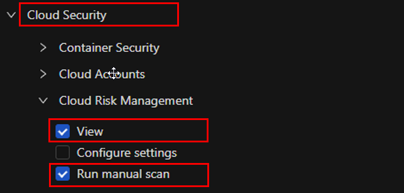
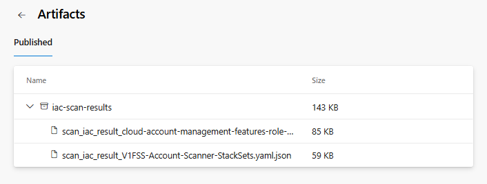

# Vision One Infrastructure as Code Scan Integration with Azure DevOps Pipelines

This guide explains how to integrate the Vision One Infrastructure as Code (IaC) Scan into Azure DevOps Pipelines.

> For more information about the Vision One platform, you can check the official documentation [here](https://docs.trendmicro.com/en-us/documentation/article/trend-vision-one-__template-scanner-2).

---

## 1. Create an API Key in Vision One

- Refer to the [API Key Creation Guide](https://docs.trendmicro.com/en-us/documentation/article/trend-vision-one-platform-api-keys).
- For best practices, it is recommended to create a custom role with the following minimum permissions:
  - Cloud Security
    - View
    - Configure settings
    - Run manual scan



---

## 2. Configure the API Key in Azure DevOps

- In your Azure DevOps Pipeline, create an environment variable named `TM_API_KEY` and assign it the value of the API Key created in the previous step.
- Make sure to mark the variable as secret.


---

## 3. Add the following code snippet to your pipeline

> **Note:** The script will automatically detect and scan all supported Terraform and CloudFormation template files.  
> **Note:** For terraform files it's necessary have the terraform plan file in .json format, you can use the `terraform show -json` command to convert it.
> For a more customized implementation, you can refer to the Trend Micro API documentation.

```yaml
# Example pipeline snippet
    - task: Bash@3
        displayName: "Copiar templates válidos a carpeta temporal"
        inputs:
        targetType: 'inline'
        script: |
            mkdir -p $(Build.ArtifactStagingDirectory)/templates
            find . -type f \( -iname "*.json" -o -iname "*.yaml" -o -iname "*.yml" -o -iname "*.template" -o -iname "*.tf.json" -o -iname "*.tf" \) | while read file; do
                cp "$file" $(Build.ArtifactStagingDirectory)/templates/
            done
    # Request the IaC scan to Vision One
    - task: Bash@3
        displayName: "Run IaC scan with Vision One Template Scanner"
        env:
        TM_API_KEY: $(TM_API_KEY)  # need to set this variable in your pipeline settings
        inputs:
        targetType: 'inline'
        script: |
            mkdir -p $(System.DefaultWorkingDirectory)/results
            docker run --rm \
            -e TM_API_KEY=$TM_API_KEY \
            -v $(System.DefaultWorkingDirectory):/src \
            -v $(System.DefaultWorkingDirectory)/results:/results \
            -w /src \
            ghcr.io/xeniap/tm_scanner_ci:latest
```

## 4. Save and run your pipeline
## 5. The scan results will be available in the Azure DevOps Pipeline Artifacts like this:



## 🤝 Contributing

Contributions are welcome!  
If you encounter any issues, bugs, or have suggestions for improvements, please feel free to [open an issue](https://github.com/xeniap/TM_CodeSecurity_CI_Integration/issues).  

We appreciate your feedback and collaboration to make this integration better for everyone.
