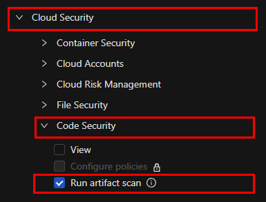
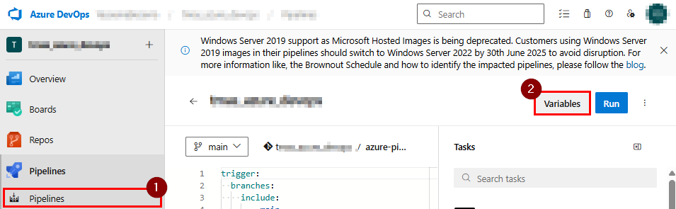
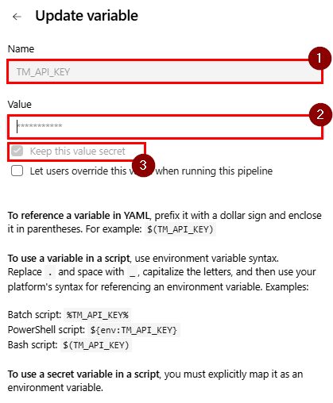

# Vision One Container Security Scan (SCA) Integration with Azure DevOps Pipelines

This guide explains how to integrate the Trend Micro Artifact Scanner (TMAS) into Azure DevOps Pipelines to scan container images for vulnerabilities, malware and secrets (Software Composition Analysis).

> For more information about the Vision One platform, you can check the official documentation [here](https://docs.trendmicro.com/en-us/documentation/article/trend-vision-one-artifact-scanner-tmas).

---

## 1. Create an API Key in Vision One

- Refer to the [API Key Creation Guide](https://docs.trendmicro.com/en-us/documentation/article/trend-vision-one-platform-api-keys).
- For best practices, it is recommended to create a custom role with the following minimum permissions:



---

## 2. Configure the API Key in Azure DevOps

- In your Azure DevOps Pipeline, create an environment variable named `TMAS_API_KEY` and assign it the value of the API Key created in the previous step.
- Make sure to mark the variable as secret.




---

## 3. Use the pipeline provided in this folder

The [`azure-pipelines.yml`](azure-pipelines.yml) in this folder implements the full workflow. Copy it into your repository, or adapt it as needed.

> **Note:** The pipeline has `trigger: none` and `pr: none`, so it runs on demand or on a schedule you define. Add your own `trigger:` / `schedules:` blocks if you want it to run automatically.

### Parameters

| Parameter      | Description                                          | Default        |
| -------------- | ---------------------------------------------------- | -------------- |
| `IMAGE`        | Container image to scan (registry reference)         | `nginx:latest` |
| `TMAS_REGION`  | Vision One region of your account (e.g. `us-east-1`) | `us-east-1`    |

### Environment variable (must be defined and secret)

| Variable       | Description                                                   |
| -------------- | ------------------------------------------------------------- |
| `TMAS_API_KEY` | Vision One API key created in [step 1](#1-create-an-api-key-in-vision-one) |

### Pipeline overview

```yaml
parameters:
  - name: TMAS_REGION
    displayName: TrendAI Vision One Region
    type: string
    default: 'us-east-1'

steps:
  - bash: |
      set -euo pipefail
      mkdir -p tools
      curl -fsSL --retry 3 \
        https://ast-cli.xdr.trendmicro.com/tmas-cli/latest/tmas-cli_Linux_x86_64.tar.gz \
        -o tmas.tar.gz
      tar -xzf tmas.tar.gz -C tools tmas
      chmod +x tools/tmas
      ./tools/tmas --version
    displayName: 'Install TMAS CLI'

  - bash: |
      set +x
      set +e
      ./tools/tmas scan "registry:${TARGET_IMAGE}" \
        -VMS \
        --region "$TMAS_REGION" \
        --evaluatePolicy \
        --report-all-fixed-versions \
        --output json=tmas-results.json \
        > tmas-scan.log 2>&1
      RC=$?
      echo "$RC" > tmas-exit-code.txt
      echo "TMAS exit code: $RC"
      exit 0
    displayName: 'TrendAI Code Security Scan'
    env:
      TMAS_API_KEY: $(TMAS_API_KEY)
      TARGET_IMAGE: ${{ parameters.IMAGE }}
      TMAS_REGION: ${{ parameters.TMAS_REGION }}

  - bash: |
      set -eu
      mkdir -p "$(Build.ArtifactStagingDirectory)/tmas"
      for file in tmas-results.json tmas-scan.log tmas-exit-code.txt; do
        if [ -f "$file" ]; then
          cp "$file" "$(Build.ArtifactStagingDirectory)/tmas/"
        fi
      done
    displayName: 'Prepare Security Artifacts'
    condition: always()

  - task: PublishPipelineArtifact@1
    displayName: 'Publish TMAS Results'
    condition: always()
    inputs:
      targetPath: '$(Build.ArtifactStagingDirectory)/tmas'
      artifact: 'TMAS-Security-Results'
      publishLocation: 'pipeline'

  - bash: |
      set -eu
      if [ ! -f tmas-exit-code.txt ]; then
        echo "##vso[task.logissue type=error]TMAS did not complete."
        exit 1
      fi
      RC=$(cat tmas-exit-code.txt)
      if [ "$RC" -eq 2 ]; then
        echo "##vso[task.logissue type=error]SECURITY GATE BLOCKED: Policy violation"
        exit 1
      fi
      if [ "$RC" -ne 0 ]; then
        echo "##vso[task.logissue type=error]TMAS scan failed: exit $RC"
        exit 1
      fi
      if [ ! -s tmas-results.json ]; then
        echo "##vso[task.logissue type=error]TMAS JSON report missing"
        exit 1
      fi
      python3 -m json.tool tmas-results.json > /dev/null
      echo "SECURITY GATE PASSED"
    displayName: 'TrendAI Security Gate'
    condition: always()
```

### What each step does

1. **Install TMAS CLI** — Downloads the latest TMAS CLI from the Vision One distribution endpoint and extracts it into `tools/`.
2. **TrendAI Code Security Scan** — Scans the remote image (`registry:<image>`) with the Vulnerability, Malware and Secrets modules (`-VMS`), evaluating the policies configured in Vision One (`--evaluatePolicy`), reporting all known fixed versions (`--report-all-fixed-versions`) and saving the report to `tmas-results.json`. The full output is written to `tmas-scan.log`.
   - This step is designed to **never fail on its own**: it records TMAS's real exit code in `tmas-exit-code.txt` so the final validation step can evaluate it.
3. **Prepare Security Artifacts** — Copia los resultados al directorio de artefactos (se ejecuta siempre, `always()`).
4. **Publish TMAS Results** — Publica el artefacto `TMAS-Security-Results` con `tmas-results.json`, `tmas-scan.log` y `tmas-exit-code.txt`.
5. **TrendAI Security Gate** — Decide el resultado final del pipeline según el código de salida de TMAS:

| Exit code | Meaning                          | Pipeline result                              |
| --------- | -------------------------------- | -------------------------------------------- |
| `0`       | Scan completed, no policy issues | ✅ Passed — `SECURITY GATE PASSED`           |
| `2`       | Policy violation detected        | ❌ Failed — `SECURITY GATE BLOCKED`          |
| other     | Scan error                       | ❌ Failed — `TMAS scan failed: exit <code>`  |

---

## 4. Save and run your pipeline

- Because `trigger: none`, launch the pipeline manually (**Run pipeline**) and provide the required parameters (`IMAGE` and `TMAS_REGION`).
- Make sure the `TMAS_API_KEY` secret variable is available (pipeline, variable group, or library).
- The build agent needs network access to the container registry that hosts `IMAGE`.

---

## 5. Review the scan results

- Results can be reviewed directly in the [Vision One console](https://cloudone.trendmicro.com/).
- The `TMAS-Security-Results` pipeline artifact is published on every run (even failures) and contains the raw JSON report, the full scan log, and the TMAS exit code recorded.

---

## 6. [Optional] Create an Excel report

If you want to generate a report in Excel format from the scan results, add the following steps to your pipeline:

```yaml
    - bash: |
        git clone https://github.com/XeniaP/CS-ArtifactScanner-Report.git
        pip install -r ./CS-ArtifactScanner-Report/requirements.txt
        python ./CS-ArtifactScanner-Report/export_report_tmas.py "$TMAS_IMAGE" --resultFile ./tmas-results.json
        FILE=$(ls *.xlsx | head -n 1)
        echo "##vso[task.setvariable variable=excelFileName]$FILE"
      displayName: Create Excel Report with Vulnerabilities
      env:
        TMAS_IMAGE: ${{ parameters.IMAGE }}
    - task: PublishPipelineArtifact@1
      inputs:
        targetPath: '$(System.DefaultWorkingDirectory)/$(excelFileName)'
        publishLocation: 'pipeline'
```

---

## 🤝 Contributing

Contributions are welcome!  
If you encounter any issues, bugs, or have suggestions for improvements, please feel free to [open an issue](https://github.com/xeniap/TM_CodeSecurity_CI_Integration/issues).  

We appreciate your feedback and collaboration to make this integration better for everyone.